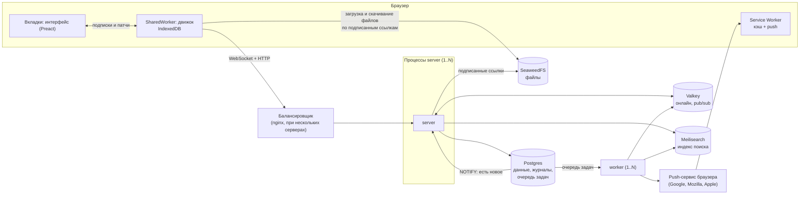
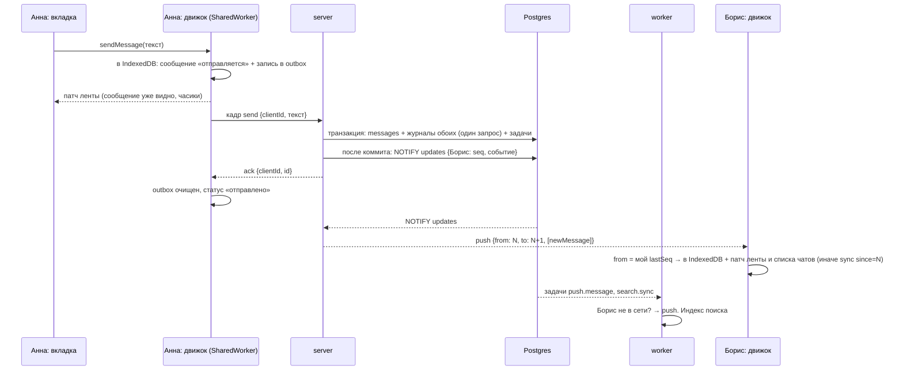

# Архитектура Relay

Relay — мессенджер в стиле Telegram Web, который работает и без сети. Этот документ объясняет, как он устроен:
из каких частей, как по ним идёт сообщение, где что хранится и что будет, если какая-то часть упадёт.
Подробности каждой части — в планах `docs/plans/` и в комментариях в коде.

---

## 1. Коротко

- **Клиент хранит всё у себя.** Чаты и сообщения лежат в браузере (IndexedDB). Интерфейс читает только локальную копию,
  поэтому открывается мгновенно и работает без сети. Отправленное без сети уходит само, когда сеть появится.
- **Сервер записывает каждое изменение в журнал пользователя.** У каждого пользователя свой пронумерованный список
  изменений: «новое сообщение», «сообщение изменено», «прочитано»… Клиент помнит номер последнего полученного
  и просит «дай всё после номера N». Так он догоняет пропущенное после офлайна, перезагрузки или с другого устройства.
- **Postgres — единственный источник правды.** Всё остальное (Valkey, Meilisearch, хранилище файлов) либо
  эфемерное, либо восстанавливается из Postgres.
- **Побочные действия выполняет отдельный процесс-воркер** из очереди задач в Postgres: push-уведомления,
  индексация поиска, письма, чистки. Задача пишется в той же транзакции, что и данные, поэтому не теряется.
- **Серверов может быть несколько.** Процессы одинаковые и ничего важного в памяти не держат; общее состояние —
  в Postgres (данные) и Valkey (кто онлайн, «печатает…»).

---

## 2. Из чего состоит

| Часть | Что это | Зачем |
|---|---|---|
| **Браузер: интерфейс** | Preact + свой UI-кит `packages/relay-ui` | Экран. Читает данные только из локальной копии через движок |
| **Браузер: движок синхронизации** | `packages/sync-engine` в SharedWorker (одна копия на все вкладки) | Хранит данные в IndexedDB, держит WebSocket, догоняет журнал, отправляет очередь |
| **Браузер: Service Worker** | `apps/web/src/sw.ts` | Кэш оболочки приложения (старт без сети), push-уведомления |
| **server** | Bun, `apps/server/src/main.ts` | HTTP API, WebSocket, вся бизнес-логика. Можно запустить несколько |
| **worker** | Bun, `apps/server/src/worker.ts` | Выполняет задачи из очереди: push, поиск, письма, чистки. Можно несколько |
| **postgres** | PostgreSQL 17 | Все данные, журналы, очередь задач, сеансы |
| **valkey** | Valkey 8 (совместимый с Redis) | Только эфемерное: кто онлайн, рассылка кадров между процессами сервера |
| **search** | Meilisearch 1.x | Индекс для поиска сообщений. Можно потерять и перестроить из Postgres |
| **s3** | SeaweedFS (S3-совместимое хранилище) | Файлы: фото, документы, голосовые, музыка |
| **web** | сборщик клиента (`apps/web/build.ts --watch`) | В dev собирает клиент; сервер раздаёт собранное |
| **migrate** | одноразовый запуск `migrate.ts` | Применяет SQL-миграции `apps/server/migrations/*.sql` по порядку |

Всё запускается в Docker: `docker compose up --build`. Приложение — на `http://localhost:3000`.



---

## 3. Главная идея: журнал обновлений

Это сердце всей системы, остальное строится вокруг него.

**Журнал** — таблица `updates(user_id, seq, type, payload)`. У каждого пользователя своя нумерация `seq`: 1, 2, 3…
без пропусков (счётчик — таблица `user_seq`). Каждая запись — одно изменение, которое этот пользователь должен увидеть.

Когда Анна пишет Борису в личный чат, в одной транзакции происходит:

1. сообщение вставляется в `messages`;
2. в журнал Анны добавляется `newMessage` с её следующим номером, в журнал Бориса — `newMessage` с его номером —
   **одним запросом на всех получателей** (`appendUpdates`): счётчики `user_seq` поднимаются в порядке `user_id`
   и остаются запертыми до коммита, поэтому у каждого номера становятся видимы по порядку и без дыр;
3. ставятся задачи в очередь (push, индекс поиска — см. раздел 8).

Сразу **после коммита** сервер отдельным запросом вызывает `pg_notify('updates', …)` (`db.ts`, `onCommit`).
Не внутри транзакции: Postgres держит замок на очередь уведомлений до конца коммита, и транзакции с NOTIFY
коммитятся строго по одной (на pgbench — 4170 → 640 tps). Откатилась транзакция — уведомления нет.

Каждый процесс сервера слушает канал `updates` (LISTEN). Получателю, которому в этой транзакции записали ровно
одну запись `newMessage`, он шлёт её сразу — кадр `push {from, to, items}` с номером получателя (уведомление
несёт само событие; длинное сообщение — не помещается в 8000 байт — идёт как `poke`). Остальным — короткий
кадр `poke` — «есть новое». Клиент применяет `push`, только если `from` равен его последнему номеру; иначе,
как и на `poke`, отвечает кадром `sync since=<последний полученный seq>` и получает пачку записей (до 500 за раз).
Если записей больше, берёт следующую пачку. Если клиент отстал настолько, что старых записей уже нет
(журнал подчищен), сервер отвечает `tooLong`, и клиент заново скачивает снимок: список чатов и последние сообщения.

Почему так, а не «отправлять сообщение прямо в сокет»:

- **Ничего не теряется.** Если сокет оборвался, клиент просто попросит «всё после N» при переподключении.
- **Порядок гарантирован.** Номера идут подряд, клиент применяет их строго по порядку.
- **Несколько устройств работают одинаково.** Телефон и ноутбук читают один журнал, каждый со своего места.
- **Несколько процессов сервера не мешают.** Записал один процесс, а `NOTIFY` дошёл до всех.
- **`push` ничего из этого не ломает.** Это тот же журнал, доставленный на шаг раньше: номер в нём настоящий,
  и клиент принимает его только на своё место. Упал процесс между коммитом и NOTIFY — клиент догонит при
  следующем событии, переподключении или сверочной синхронизации (раз в полторы минуты).

### 3.1. Второй журнал: на чат (группы и каналы)

Личный журнал стоит столько записей, сколько получателей: сообщение в группу на 3000 — 3000 строк и 3000 замков
`user_seq`, на этом группа упиралась в 10 сообщений/с. Поэтому у **групп и каналов свой журнал** — как `pts` канала
в Telegram: `chat_seq(chat_id, seq, updated_at)` и `chat_updates(chat_id, seq, type, payload)`. Событие группы
(сообщение, правка, удаление, реакции, закрепы, чек-лист, превью, вложение, состав `members`, `groupUpdated`) —
**одна** запись, сколько бы участников ни было. Личные чаты остаются на личном журнале.

**Что остаётся личным** и в группах: `readOwn` (моё «прочитано до»), черновики, флаги и уведомления чата,
`membership` (моя роль; при вступлении — с `seq` чата на момент коммита: догонять историю до вступления не
нужно), `chatRemoved`, `joinRequests` (число заявок — только тем, кто их принимает; общая запись `groupUpdated`
этого поля не несёт), `readBy` — не всем участникам, а **только авторам прочитанных сообщений** (стоимость по
сообщениям, не по участникам).

**Запись.** Оба журнала пишутся в момент коммита (`db.ts` `beforeCommit`, `journal.ts` `flushJournals`): тело
транзакции лишь копит записи (`chatEvent`, `appendUpdates`, `membershipEvent`), а хук перед коммитом пишет их
одним запросом каждый, всегда в порядке «журналы чатов по возрастанию `chat_id` → личный по возрастанию
`user_id`». Один порядок замков для всех транзакций, замки живут от хука до коммита. Инвариант тот же: у чата
номера видимы по порядку и без дыр.

**Доставка.** После коммита — один `pg_notify('chat_updates', {c, f, t, e})` на чат (`e` — все события транзакции,
если влезают в 8000 байт; иначе без `e`). Сокет подписан на `chat:<id>` всех своих групп (`sockets.ts`: Bun
pub/sub в процессе плюс топик в Valkey для «печатает…»); процесс делает **один** `publish` — кадр
`push {chatId, from, to, items}` у всех одинаковый, потому что номер общий. Вступление и исключение подписывают
и отписывают живые сокеты через `s`/`x` в уведомлении личного журнала; `hello` и `chatsSince` сверяют подписки с
`chat_members` — страховка.

**Длинное событие** (уведомление без `e`: длинный пост, большая транзакция). Раньше процесс публиковал пустой
`push`, и каждый сокет чата отвечал `syncChat` — на канале с 2000 онлайн это 2000 одинаковых чтений журнала.
Теперь процесс (`realtime.ts`) **один раз** читает записи `(f, t]` (`chatJournal.ts` `getChatUpdatesRange`: без
фильтра по пользователю, с подстановкой сообщений) и публикует полный `push`. Чтобы `push` одного чата не обгоняли
друг друга, у процесса очередь на чат (`Map<chatId, Promise>`): пока чтение в полёте, следующие уведомления этого
чата — и с `e`, и без — встают за ним; запись карты удаляется, когда очередь пуста. Быстрый путь (есть `e`, очереди
нет) остаётся синхронным. Скрытую историю (`history_from`) у такого `push` отбрасывает клиент — как и у обычного.
Пустой `push` (клиенты догоняют сами) остался только на случай, если чтение не удалось или записей больше пачки.

**Каналы** (`kind = 'channel'`) — тот же журнал чата; пишут только админы с правом `post`, у поста `senderId 0`
(автор — во внутреннем `sender_id`, подпись — по настройке канала). Вступление и выход подписчика не пишут в журнал
чата ничего (ни служебного, ни `members`) — только личный `membership`; `members_count` держит триггер.
Подписчикам в журнал не пишется ничего на каждого: пост, просмотры (`views`, узкая таблица, дедуп и лимит в Valkey),
реакции счётчиками.

**Копии постов и комментарии.** У канала может быть группа обсуждения: каждый пост получает в ней **копию** —
обычное сообщение группы с `origin` и `post = true`, перешифрованное ключом группы; копия — корень треда
(`message_threads`), комментарии — сообщения группы с `thread_id`. Правки, удаление, превью ссылки и чек-листы
поста доходят до копии в той же транзакции (`withCopy`, замки «пост → копия»). Push группы для копии пропускает
подписчиков канала — одно уведомление на пост.

**Коалесцирующие задачи.** Частые счётчики не пишутся в журнал на каждое изменение: комментарий ставит
`replies.flush`, реакция поста — `reactions.flush` с `dedupe_key` на секундное окно (`run_at` — конец окна).
Сколько бы ни было изменений за секунду — одна задача и одно событие `replies` / `reactionCounts` в журнале канала.

**Web Push страницами.** `push.message {chatId, id, after?}` читает подписки чата страницей по 1000
(`push_subscriptions join chat_members`, курсор `(user_id, endpoint)` по первичному ключу подписок плюс
`m.user_id >= after_uid` — страница идёт по ключу `chat_members`), один `onlineUsers` на страницу, и **одной
транзакцией**: массовая вставка `push.deliver` (`dedupe_key = push.deliver:<endpoint>:<id>`, `on conflict do
nothing`), продолжение со своим курсором (если страница полная) и `delete` самой задачи `where id and attempts`.
Строку уже не удалить — аренду перехватил другой воркер: откат, ничего не вставлено. Либо всё, либо ничего — повтор
даёт каждую доставку один раз. `pg_notify('jobs', 'push.deliver')` — после коммита (вставка идёт мимо `enqueue`).
Число страниц — по числу подписок, а не участников: канал 200 000 с 2000 подписками — две страницы на пост.
Предел честно: это O(подписчиков с Web Push и без mute) доставок на пост — фоновая стоимость уведомлений, не путь
отправки. Канал, где Web Push включён у всех 198 000 офлайн, — это ~200 000 доставок на пост; без серверного
fan-out у Web Push (одна доставка на подписку) это не убрать, такой сценарий не поддерживается.

Замеры (канал 20 000 и 200 000 при 2000 онлайн, push-подписки у 2000 офлайн, комментарии в один тред группы
3000) — таблица в `docs/superpowers/specs/2026-10-23-chat-journal-design.md`, «Результаты части 2».

**Клиент** (`engine.ts`, раздел «Журнал чата») держит `chatSeq[chatId]` в IndexedDB и:
- применяет `push`, если `from` равен номеру чата — открыт чат или нет;
- `from` больше номера — уведомления разных транзакций могут прийти не по порядку: кадр ждёт в буфере 700 мс
  недостающий, не дождался — `syncChat {chatId, since}` (пачки `chatUpdates`, как `sync`);
- на `hello {since}` сервер называет группы, менявшиеся после `since` (мс по часам базы): открытые и верхние в
  списке догоняются сразу, остальные в фоне по четыре; `since` записывается, только когда всё догнано;
- незнакомый чат (вне загруженных страниц, вступление) — его строку по id (`/chats?ids=`), она несёт `seq`;
- `chatTooLong` (журнал чата подрезан) сбрасывает ленту **только этого чата**; `chatGone` — чат удалён;
- вступил при скрытой истории — события по сообщениям до `history_from` сервер отдаёт как `messageDeleted`, а
  клиент пропускает их и в живых push.

**Архив.** Сообщение в архивный незаглушённый чат возвращает его из архива (как в Telegram). В личном чате это
делает сервер (`unarchiveOnMessage`, два участника). В группе писать каждому участнику на каждое сообщение
нельзя, поэтому решает клиент, а сервер **проверяет**: `POST /chats/:id/unarchive {messageId}` снимает архив,
только если сообщение новее границы `archived_at_id` (ставится при каждой записи `archived = true`), не моё и
чат не заглушён на момент операции. Повтор старых событий (второе устройство, догонка) архив не снимает; пока
операция в очереди, чат показан вне архива оверлеем, в стор пишется только ответ. Если все устройства были
офлайн, группа остаётся в архиве до первого `syncChat` этого чата.

**Что остаётся пропорциональным числу участников** (не на пути отправки): Web Push офлайн-участникам с подпиской
(`push.message` страницами, фоновая задача), строка списка группы (`count(*)`), операции администратора (права каждому,
обмен профилями при вступлении), подписка сокета при открытии (по числу групп пользователя).

Типы записей журнала (`packages/protocol/src/index.ts`): `newMessage`, `messageEdited`, `messageDeleted`, `reactions`,
`readOwn` (я прочитал на другом устройстве), `readBy` (собеседник прочитал моё), `draft`, `pins`, `mediaListened`,
`contactsChanged`, `blocksChanged`, `privacyChanged`, `settingsChanged`, `sessionsChanged`, `userUpdated`, `link`.

---

## 4. Путь сообщения от кнопки «Отправить» до собеседника



По шагам и простыми словами:

1. **Вкладка** вызывает движок: «отправь текст в чат 42».
2. **Движок** сразу кладёт сообщение в IndexedDB со статусом «отправляется» и временным ключом `clientId` (UUID),
   а в очередь `outbox` — запись «надо отправить». Интерфейс получает патч и сразу показывает сообщение с часиками.
   Всё это происходит без сети.
3. Если сеть есть, движок шлёт кадр `send`. Если нет — сообщение ждёт в `outbox` и уйдёт при подключении
   (переживает и перезагрузку, и закрытие браузера).
4. **Сервер** (`domain/messages.ts`, `sendMessage`) в одной транзакции проверяет права, вставляет сообщение,
   пишет записи в журналы всех участников, ставит задачи `push.message` и `search.sync`, очищает черновик.
5. **Повтор не создаёт дубль.** У сообщения уникальная пара `(sender_id, client_id)`. Если `ack` потерялся и движок
   отправил то же самое ещё раз, сервер найдёт уже вставленное и ответит тем же `id` (`duplicate: true`).
6. **Сервер отвечает `ack`**, движок связывает `clientId` с настоящим `id` и ставит галочку.
7. **Борис**: его процесс сервера получает `NOTIFY` с событием и номером Бориса и шлёт `push`; движок Бориса
   применяет его, если номер следующий за его `lastSeq`, иначе делает `sync` и получает `newMessage` так.
8. **Воркер** забирает задачи: решает, слать ли Борису push (только если у него нет открытой вкладки ни в одном
   процессе), и добавляет сообщение в индекс поиска.

---

## 5. Клиент

### 5.1. Три уровня в браузере

| Уровень | Где работает | Что делает |
|---|---|---|
| **Интерфейс** | вкладка, главный поток | Рисует. Состояние экрана — `apps/web/src/global.ts`, связь с движком — `apps/web/src/data.ts` |
| **Движок** | SharedWorker `shared.worker.js` — один на все вкладки. Где SharedWorker нет — Dedicated Worker в каждой вкладке, а работает только «лидер», выбранный через Web Locks | Хранит данные, синхронизирует, отправляет |
| **Service Worker** | `sw.js` | Кэш оболочки (страница, скрипты, стили) — приложение стартует без сети; приём push и клик по уведомлению |

Один движок на все вкладки — это один WebSocket, одна запись в IndexedDB и никаких расхождений между вкладками.

### 5.2. Локальная база (IndexedDB)

База `relay-<userId>`, хранилища (`packages/sync-engine/src/idb.ts`):

| Хранилище | Что лежит |
|---|---|
| `chats` | список чатов: название, непрочитанные, последнее сообщение, черновик |
| `messages` | сообщения, индекс `byChat (chatId, sort)` для ленты |
| `outbox` | неотправленные сообщения |
| `blobs` | файлы, ещё не загруженные на сервер (вложения из очереди) |
| `pendingReads` | «прочитано», ещё не отправленное серверу |
| `ops` | очередь операций настроек (профиль, контакты, приватность, сеансы) |
| `users` | профили собеседников |
| `meta` | `lastSeq` (докуда догнали журнал), `epoch` и прочее служебное |

**Поле `sort`** задаёт порядок в ленте. У отправленных сообщений это их `id`, у ещё не подтверждённых —
`2^52 + время создания`, поэтому они всегда внизу, пока сервер не даст настоящий номер.

### 5.3. Подписки и патчи

Интерфейс не читает IndexedDB сам. Он подписывается на «живые запросы» (`packages/sync-engine/src/types.ts`, `Query`):

- `chatList` — список чатов;
- `messages` — окно ленты: последние N сообщений или N вокруг нужного (для перехода к сообщению);
- `counters` — непрочитанные;
- `status` — фаза синхронизации;
- `presence`, `me`, `user`, `contacts`, `settings`, `blocked`, `ops` и служебные `devStats`, `devLog`.

На подписку движок отдаёт **снимок** (`snapshot`), потом только **изменения** (`diff`: что добавить, что убрать,
новый порядок). Изменения собираются и отдаются не чаще раза в кадр (16 мс). На стороне вкладки класс `Mirror`
применяет патчи и отдаёт готовый список.

### 5.4. Фазы синхронизации

Движок сообщает интерфейсу, что происходит; надпись видна в поле поиска.

| Фаза | Надпись | Значит |
|---|---|---|
| `connecting` | «Подключение…» | открываем WebSocket |
| `loading` | «Загрузка чатов…» | первый вход: качаем снимок |
| `updating` | «Обновление…» | догоняем журнал |
| `offline` | «Ожидание сети…» | сети нет, работаем с локальной копией |
| `ready` | — | всё синхронизировано |

### 5.5. Две очереди: сообщения и операции

- **Очередь сообщений** (`outbox`) — отправка, файлы, повторы. Сообщение никогда не теряется: оно в IndexedDB,
  пока сервер не подтвердит.
- **Очередь операций** (`ops`, `packages/sync-engine/src/ops.ts`) — HTTP-изменения настроек: имя, фото, контакты,
  приватность, сеансы. Одинаковые правки схлопываются (две смены имени подряд — один запрос), отправка строго
  по порядку, сетевые ошибки и 5xx повторяются, 4xx — отказ, который показывается пользователю.

### 5.6. Сброс локальной копии (epoch)

На сервере есть «поколение базы» — строка `epoch` в `server_meta`. Если данные на сервере пересоздали
(например, dev-seed с `--reset`), поколение меняется. Клиент видит другое поколение в ответе `hello` и стирает
локальную копию, чтобы не показывать сообщения, которых больше нет.

### 5.7. Интерфейс

- **Лента** (`apps/web/src/ui/Feed.tsx`) держит в DOM только окно сообщений (две «порции» по высоте экрана)
  и подгружает края при прокрутке. Положение прокрутки сохраняется и восстанавливается до отрисовки, без прыжков.
- **Список чатов** — виртуальный список фиксированной высоты (`WindowList` в UI-ките).
- **Чтение и запись раскладки разделены по фазам кадра** (`packages/relay-ui/src/schedule.js`, по идее fasterdom):
  измерения в одной фазе, изменения DOM в другой. В dev-сборке это проверяет `strict.js` и сообщает о нарушениях.
- **Плавность — главное требование:** лоадеры появляются с задержкой и держатся минимальное время,
  состояния сменяются через crossfade, без вспышек пустых экранов. Правила и как их проверять —
  [docs/SMOOTH-UI.md](docs/SMOOTH-UI.md).

---

## 6. Сервер

### 6.1. Слои

```
HTTP-запрос / кадр WebSocket
        │
        ▼
http.ts, authRoutes.ts, ws.ts     ← транспорт: разобрать запрос, узнать пользователя по cookie, вызвать функцию
        │
        ▼
domain/*.ts                        ← бизнес-логика: одна функция = одно действие, своя транзакция, свой SQL
        │
        ▼
Postgres (+ Valkey, Meilisearch, S3 — только через свои модули)
```

- **Транспорт** ничего не решает сам: только разбор, проверка входа и ответ.
- **Домен** — обычные async-функции вроде `sendMessage(userId, input)`. Каждая сама открывает транзакцию
  (`sql.begin`), проверяет права и пишет SQL напрямую (библиотека postgres.js). Отдельного слоя репозиториев нет:
  при таком объёме транзакция на действие проще и надёжнее.
- **Ошибки** — `DomainError(code)`: `not_member`, `not_found`, `forbidden`, `blocked`, `too_long`, `bad_frame`…
  Транспорт превращает их в HTTP-статус или кадр `err`. Неожиданная ошибка — `internal` с `retry: true`.

### 6.2. Модули домена (`apps/server/src/domain/`)

| Модуль | За что отвечает |
|---|---|
| `messages.ts` | отправка сообщения |
| `messageOps.ts` | правка, удаление, реакции, «прослушано» |
| `chats.ts` | создание чатов, список чатов (страницами), история, медиа чата |
| `reads.ts` | «прочитано» |
| `drafts.ts` | черновики (синхронизируются между устройствами через журнал) |
| `pins.ts` | закреплённые сообщения |
| `journal.ts` | запись в журнал (`appendUpdates`, `fanOut`), чтение пачками (`getUpdates`) |
| `presence.ts` | «в сети» / «был(а)», «печатает…» |
| `liveRegistry.ts` | кто онлайн во всей системе (Valkey) |
| `privacy.ts` | правила приватности (кто видит время входа и т. п.) |
| `contacts.ts`, `users.ts`, `profile.ts`, `profileMusic.ts` | контакты, профили, @username, музыка в профиле |
| `settings.ts` | настройки пользователя, папки чатов, умолчания уведомлений |
| `sessions.ts` | сеансы: список, завершение, подтверждение «Это вы?», автозавершение |
| `login.ts`, `password.ts`, `passkeys.ts`, `qrLogin.ts` | вход: код, облачный пароль (SRP), паскеи, QR |
| `service.ts` | служебный чат «Relay» (коды входа, «Новый вход в аккаунт») |
| `files.ts` | загрузки в S3, выдача ссылок, чистка брошенных загрузок |
| `uploadLimits.ts`, `storageGc.ts` | пределы загрузок на пользователя, сборка мусора в хранилище |
| `push.ts` | Web Push: подписки, кому слать, шифрование и доставка |
| `search.ts` | поиск сообщений (Meilisearch с запасным путём через Postgres) |
| `epoch.ts` | поколение базы |
| `devOutbox.ts` | dev-почта (письма восстановления пароля без настоящего почтового шлюза) |

### 6.3. Протокол WebSocket

Соединение — `/ws` с cookie `relay_session`. Кадры — JSON с полем `op`.

**Клиент → сервер:**

| Кадр | Что делает |
|---|---|
| `hello` | начало: в ответ — текущий `seq` и `epoch` |
| `sync {since}` | «дай журнал после since» → `updates` или `tooLong` |
| `send` | отправить сообщение → `ack` |
| `read {chatId, upToId}` | прочитано до сообщения |
| `edit`, `delete`, `react`, `listened` | правка, удаление, реакция, «прослушано» |
| `draft` | черновик |
| `typing` | «печатаю» (ответа нет, уходит собеседникам) |
| `ping` | проверка связи → `pong` |

**Сервер → клиент:** `ack`, `err`, `updates`, `tooLong`, `poke` (есть новое в журнале), `push` (запись журнала
сразу: применяется, если `from` — последний номер клиента; с `chatId` — журнала чата), `hello {seq, epoch, now,
chats}`, `chats`, `chatUpdates`, `chatTooLong`, `chatGone` (журналы чатов), `presence`, `typing`,
`sessionTerminated` (сеанс завершён — клиент выходит и стирает данные), `pong`.

HTTP используется для того, что не нужно в реальном времени или работает с файлами: список чатов страницами,
история, поиск, профиль, настройки, контакты, сеансы, загрузки, вход.

---

## 7. Где что хранится

### 7.1. Postgres — данные и всё, что должно пережить перезапуск

| Группа | Таблицы |
|---|---|
| Пользователи и профиль | `users`, `profile_music`, `user_settings`, `privacy_rules`, `contacts`, `blocks` |
| Чаты и сообщения | `chats`, `chat_members`, `messages`, `reactions`, `drafts`, `pinned_messages`, `attachments`, `service_chats` |
| Журнал | `updates` (записи), `user_seq` (последний номер пользователя) |
| Очередь задач | `jobs`, `jobs_dead` |
| Вход и сеансы | `sessions`, `login_attempts`, `login_pending`, `user_passwords`, `srp_challenges`, `password_recovery`, `passkeys`, `webauthn_challenges`, `qr_logins` |
| Push | `push_subscriptions` |
| Служебное | `server_meta` (epoch, ключи VAPID, готовность индекса поиска), `schema_migrations`, `dev_mail` |

Миграции — нумерованные SQL-файлы `apps/server/migrations/NNN_*.sql`, применяются по порядку один раз.

### 7.2. Valkey — только эфемерное

Потеря Valkey не теряет ни одного сообщения: пропадают только онлайн и «печатает…», и они восстанавливаются сами.
Все ключи и каналы — с префиксом `relay:` (в тестах `relay_test:`).

| Ключ / канал | Что значит |
|---|---|
| `presence:<user>` | хэш «процесс → сколько сокетов этого пользователя в нём» |
| `proc:<pid>` | процесс сервера жив (обновляется каждые 30 с, живёт 90 с) |
| `left:<user>` | пауза после ухода последнего сокета: перезагрузка вкладки — не «вышел» |
| канал `t:user:<id>`, `t:session:<id>` | кадры для сокетов пользователя или сеанса, где бы они ни были |

### 7.3. SeaweedFS (S3) — файлы

Бакет `relay-files`, ключ объекта — id вложения. Байты файла **не идут через сервер**:

1. клиент просит `POST /uploads` и получает подписанную ссылку на загрузку (PUT);
2. кладёт файл прямо в хранилище;
3. подтверждает `POST /uploads/:id/confirm` — сервер сверяет размер и тип по HEAD;
4. только после этого вложение можно отправить сообщением.

Скачивание: `GET /files/:id` проверяет, что пользователь в чате с этим файлом, и отвечает редиректом (302)
на подписанную ссылку, которая живёт 10 минут. Брошенные загрузки (не подтверждённые за сутки) удаляет
периодическая задача `uploads.sweep`.

**Пределы и сборка мусора** (`uploadLimits.ts`, `storageGc.ts`). `POST /uploads` пропускает не больше
10 идущих загрузок на пользователя, 120 заявок в минуту, 10 ГБ в час и 50 ГБ в сутки (`UPLOAD_MAX_PENDING`,
`UPLOAD_PER_MINUTE`, `UPLOAD_GB_PER_HOUR`, `UPLOAD_GB_PER_DAY`); отказ — 429 `upload_limit` / `flood` / `upload_quota`
с `Retry-After`, клиент показывает тост. Счётчики — в Valkey (один EVAL на заявку, к S3 — ничего лишнего), без Valkey
пределы байт и flood не действуют. Задача `storage.gc` удаляет готовые вложения старше `UPLOAD_GC_GRACE_DAYS` (7),
на которые не ссылается ни одно не удалённое сообщение (пересылки — тот же id), музыка или фото профиля, фото группы,
превью ссылки, — вместе с объектами в S3 (задача `attachment.purge`). Дедупликации по содержимому нет: хэш с клиента
подделывается (чужой файл «по хэшу»), а хэшировать 2 ГБ на сервере — читать объект целиком ради редкого совпадения.
Объём и квоту пользователя видно в `/dev/stats` (Настройки → Для разработчиков).

Почему SeaweedFS, а не MinIO: у MinIO урезали бесплатную версию. API у них одинаковый (S3), поэтому замена
хранилища не меняет кода — только адрес и ключи.

### 7.4. Meilisearch — индекс поиска

Индекс `relay_messages`: `id`, `chatId`, `body`, `attachmentName`. **Прав доступа в индексе нет** (см. раздел 10).
Индекс можно удалить в любой момент — воркер перестроит его из Postgres.

---

## 8. Очередь задач и воркер

Всё, что не нужно делать до ответа пользователю, выполняет отдельный процесс `worker` (`apps/server/src/jobs/`).

### Как это работает

1. **Постановка.** Доменная функция вызывает `enqueue(tx, kind, payload)` **внутри своей транзакции**.
   Откатилась транзакция — задачи нет. Закоммитилась — задача точно есть (это называется transactional outbox).
2. **Пробуждение.** После коммита `pg_notify('jobs', kinds)` (один на транзакцию, отдельным запросом — см. раздел 3,
   почему не внутри) будит воркеры; кроме того, воркер раз в 5 секунд проверяет очередь сам (для отложенных повторов).
3. **Захват.** Воркер берёт пачку задач запросом `select … for update skip locked`: несколько воркеров
   не берут одну задачу, а свободные задачи не ждут занятых. Задача получает «аренду» на 5 минут (`locked_until`).
4. **Выполнение.** Обработчик выполняется вне транзакции. Успех — задача удаляется. Воркер работает конвейером:
   до `WORKER_CONCURRENCY` задач в работе, освободившиеся места сразу добираются новыми, так что медленная задача
   не держит остальные. Готовые задачи удаляются одним `delete` на все, что закончились за время предыдущего.
   `search.sync` идёт пачками до 200 (своя полоса): одно чтение строк и один запрос в Meilisearch на индекс;
   пачка упала — её задачи выполняются по одной, и одна плохая не держит остальные.
5. **Ошибка** — повтор с нарастающей паузой: 1 с, 2 с, 4 с… до 10 минут. После исчерпания попыток (по умолчанию 8)
   или при ошибке, которую повторять бессмысленно (`PermanentError`), задача уходит в `jobs_dead` с текстом ошибки.
6. **Воркер упал** посреди задачи — аренда истечёт, и задачу возьмёт снова этот или другой воркер.
   Поэтому каждый обработчик должен спокойно переносить повтор («как минимум один раз»).

Секреты в задачах (например, код восстановления) кладутся под ключ `secret`: в `jobs_dead` он не копируется.

### Какие задачи есть

| Задача | Когда ставится | Что делает |
|---|---|---|
| `push.message` | новое сообщение (обычное или служебное) | страница подписок (по 1000): кому слать push, `push.deliver` на каждую и продолжение — одной транзакцией вместе с удалением себя (раздел 3.1) |
| `push.mention` | упоминание | push одному упомянутому, сквозь mute |
| `replies.flush`, `reactions.flush` | комментарий, реакция на пост (секундное окно, `dedupe_key`) | одно событие счётчиков в журнал канала |
| `chat.purge` | удаление канала или группы | участники, сообщения и сам чат — страницами |
| `push.deliver` | из `push.message` | шифрует и отправляет одно уведомление; 404/410 — забывает подписку; 429/5xx — повтор |
| `search.sync` | отправка, правка, удаление | приводит документ в индексе к текущей строке в Postgres |
| `search.reindex` | индекс не той версии; dev-seed | шаг перестройки индекса (до 30 с): копирует порцию, ставит продолжение себя; последний шаг меняет индексы местами |
| `mail.recovery` | «Забыли пароль?» | отправляет код (в dev — в `dev_mail`, видно на `/dev/codes`) |
| `sessions.sweep` | периодическая, раз в час | завершает истёкшие и неактивные сеансы |
| `uploads.sweep` | периодическая, раз в час | удаляет брошенные загрузки |
| `storage.gc` | периодическая, раз в час (большая таблица — пачками подряд) | удаляет вложения, на которые ничто не ссылается, ставит `attachment.purge` |
| `attachment.purge` | из `storage.gc` | удаляет объекты вложения в S3: оригинал, перепакованный оригинал, копии видео |

Периодические задачи — это одна строка на вид (`dedupe_key`), которую обработчик после выполнения переносит вперёд.
Сколько бы воркеров ни было, чистка идёт одна.

---

## 9. Несколько процессов сервера

Процессы `server` одинаковые и стоят за балансировщиком (`docker-compose.scale.yml` поднимает второй процесс и nginx
на `:3080`). Чтобы это работало, у процесса не должно быть важного состояния в памяти:

| Что | Где живёт | Как доходит до нужного процесса |
|---|---|---|
| Данные, журналы | Postgres | клиент читает журнал через любой процесс |
| «Есть новое в журнале» | `NOTIFY updates` сразу после коммита | каждый процесс слушает канал: `push` или `poke` своим |
| Событие группы | `NOTIFY chat_updates` после коммита | каждый процесс делает один `publish` в `chat:<id>` своим подписчикам |
| «Сеанс завершён» | `NOTIFY sessions` | каждый процесс закрывает свои сокеты этого сеанса |
| «Печатает…», присутствие, изменения контактов и приватности | pub/sub Valkey | процесс подписан на топики своих сокетов и раздаёт им пришедшее |
| Кто онлайн | Valkey (`presence:<user>`) | счётчики по процессам, сумма считается атомарно скриптом |
| Сокеты | в памяти процесса | это нормально: кадры к ним приходят через NOTIFY и Valkey |

**Почему «есть новое» осталось на `NOTIFY`, а не переехало в Valkey:** уведомление шлёт тот же код сразу после
коммита, и клиента не разбудят раньше, чем данные записаны; порядок доставки — порядок коммитов уведомлений.
Pub/sub Valkey ни того, ни другого не гарантирует.

**Липкие сессии балансировщику не нужны:** HTTP-запрос и сокет одного пользователя могут попасть в разные процессы.

---

## 10. Поиск

- **Обычный путь.** Сервер берёт из Postgres список чатов пользователя и спрашивает Meilisearch:
  «найди эти слова среди сообщений этих чатов, новые сверху». Meilisearch возвращает только id.
  Сервер заново читает эти сообщения из Postgres, проверяя членство и то, что сообщение не удалено.
  Так чужое или удалённое не покажется, даже если индекс отстал.
- **Как ищет.** По словам и их началу («встр» находит «встреча»), прощает опечатки, ищет и по имени файла.
  Любую подстроку внутри слова не ищет: так устроен поиск в Telegram и почтовых клиентах.
- **Обновление индекса** — задачей `search.sync` после каждого изменения. Обработчик читает текущую строку:
  есть и не удалено — записать, иначе — убрать. Повтор и порядок задач значения не имеют. Воркер берёт эти задачи
  пачками (`syncMessages`): под нагрузкой индекс успевает за ~700 сообщений в секунду.
- **Коды входа** (служебные сообщения `login_code`) в индекс не попадают никогда.
- **Перестройка** (`search.reindex`): новый индекс строится рядом, пока старый отвечает на запросы.
  На это время изменения пишутся в оба. Строится по шагам: каждая задача копирует порцию (не дольше 30 секунд,
  чтобы уложиться в аренду), запоминает курсор в `server_meta.search_reindex_after` и ставит следующий шаг.
  Перезапуск воркера посередине теряет только недописанную порцию — следующий шаг продолжит с курсора.
  Когда копировать нечего, индексы меняются местами (swap). Готовность — версия в `server_meta.search_index`.
- **Запасной путь.** Индекс не построен или Meilisearch недоступен — поиск подстроки по Postgres (`ILIKE`
  с триграммным индексом). Медленнее на больших объёмах, но работает.
- **Без сети** клиент ищет по своей локальной копии.

---

## 11. Онлайн и «печатает…»

- **Онлайн.** Сокет открылся → `connect` в Valkey прибавляет единицу к счётчику пользователя в этом процессе и
  возвращает сумму по всем живым процессам. Сумма стала 1 (первое устройство во всей системе) и это не возврат
  после короткого обрыва → собеседникам уходит «в сети».
- **Уход.** Сокет закрылся → `disconnect`. Сумма стала 0 → ставится ключ-пауза (`left:<user>`, 4 секунды).
  Через паузу процесс проверяет: если пользователь так и не вернулся ни в один процесс, записывает `last_seen_at`
  и рассылает «был(а) в …». Поэтому перезагрузка вкладки не мигает «был(а) только что».
- **Упавший процесс** перестаёт обновлять `proc:<pid>`; через 90 секунд его счётчики перестают учитываться.
- **Приватность.** Кому правило «Последний визит» не разрешает видеть время, тот получает «недавно» и не получает
  кадров о входе и выходе вовсе (иначе само время кадра выдало бы, когда человек в сети).
- **«Печатает…»** — кадр `typing` от клиента сервер рассылает остальным участникам чата через Valkey.
  В базу и журнал не пишется.

---

## 12. Уведомления

Два пути, чтобы уведомление пришло всегда, но не дважды:

1. **Вкладка открыта, но окно не в фокусе** — уведомление показывает сам клиент по новому сообщению в списке чатов.
2. **Вкладок нет** — сервер шлёт Web Push. Задача `push.message` проверяет в Valkey, что у получателя нет ни одного
   сокета, учитывает заглушённые чаты, блокировки, умолчания уведомлений и настройку «скрывать текст».
   `push.deliver` шифрует уведомление (aes128gcm, RFC 8291), подписывает ключом VAPID (RFC 8292) и отправляет
   в push-сервис браузера. Всё это написано без сторонних библиотек.

Оба пути используют одинаковый `tag` уведомления на чат: новое заменяет старое, а не копится. Клик по уведомлению
поднимает вкладку и открывает чат.

---

## 13. Вход и сеансы

- **Сеанс** — случайный токен в cookie `relay_session`. В базе хранится только его хэш. Каждый вход —
  отдельная строка `sessions`: устройство, IP, время, последняя активность.
- **Способы входа:**
  - **код** — приходит в служебный чат «Relay» на уже вошедших устройствах (как в Telegram);
  - **QR** — новое устройство показывает код, вошедшее его подтверждает;
  - **паскей** (WebAuthn) — без телефона и кода;
  - **облачный пароль** — вторая ступень после кода, QR или паскея. Проверяется по протоколу SRP-6a:
    сам пароль на сервер не передаётся. Восстановление — кодом на почту (задача `mail.recovery`).
- **«Это вы?»** — новый вход по коду считается неподтверждённым, пока его не подтвердят с другого устройства.
  Такой сеанс не может завершать другие.
- **Завершение сеанса** (с другого устройства или по сроку) рассылается через `NOTIFY sessions`. Сокеты этого
  сеанса получают `sessionTerminated` и закрываются, клиент стирает локальные данные.
- **Автозавершение** неактивных сеансов — по сроку, который выбирает пользователь (задача `sessions.sweep`).

---

## 14. Что будет, если упадёт…

| Упало | Что перестаёт работать | Что продолжает | Что потом |
|---|---|---|---|
| **Сеть у клиента** | связь с сервером | чтение всего, отправка (в очередь), поиск по локальной копии | очередь уйдёт сама, журнал догонится |
| **Один процесс server** | его сокеты рвутся | остальные процессы; клиенты переподключаются через балансировщик | через 90 с его онлайн-счётчики забываются |
| **worker** | push, индексация поиска, письма, чистки | сообщения, синхронизация, поиск (по старому индексу или Postgres) | задачи ждут в `jobs` и выполнятся после запуска |
| **Valkey** | онлайн, «печатает…», кадры контактов между процессами | сообщения, журнал, синхронизация | процесс переподключается сам; push не узнаёт, кто онлайн — задачи уходят на повтор |
| **Meilisearch** | быстрый поиск | поиск по Postgres (подстрока) | `search.sync` ждёт в очереди; индекс можно перестроить |
| **SeaweedFS (S3)** | загрузка и скачивание файлов | всё остальное | загрузки из очереди клиента повторятся |
| **Push-сервис браузера** | push | всё остальное | `push.deliver` повторяет с паузами, потом `jobs_dead` |
| **Postgres** | почти всё на сервере | клиенты работают с локальной копией | всё восстановится; ничего не потеряно, кроме неподтверждённого клиентам |

---

## 15. Где что лежит в коде

```
apps/
  server/
    migrations/        SQL-миграции по порядку
    src/
      main.ts          процесс server: HTTP + WebSocket + LISTEN
      worker.ts        процесс worker: очередь задач
      http.ts          HTTP-маршруты и WebSocket
      authRoutes.ts    маршруты входа
      ws.ts            обработка кадров WebSocket
      realtime.ts      LISTEN updates/sessions, «процесс жив»
      bus.ts           рассылка кадров между процессами (Valkey pub/sub)
      valkey.ts        клиент Valkey, префикс ключей
      db.ts            подключение к Postgres
      domain/          бизнес-логика (раздел 6.2)
      jobs/            очередь: queue.ts, worker.ts, handlers.ts, kinds.ts (все виды задач)
      search/          Meilisearch: клиент и индекс сообщений
      dev/             seed и dev-инструменты
    test/              тесты сервера (настоящие Postgres, Valkey, Meilisearch, S3 в Docker)
  web/
    src/
      main.tsx         старт: вход, регистрация Service Worker, запуск движка
      data.ts          подписки движка → состояние экрана
      global.ts        состояние экрана
      sw.ts            Service Worker
      notify.ts        уведомления
      ui/              экраны: Sidebar, Chat, Feed, Info, настройки, вход…
packages/
  protocol/            общие типы: кадры, записи журнала, папки, ссылки, SRP
  sync-engine/         движок: engine.ts, store.ts, idb.ts, queries.ts, transport.ts, ops.ts, hosts/
  relay-ui/            UI-кит: компоненты, планировщик кадров, strict-DOM, стили
docker/                конфиги контейнеров (nginx, инициализация бакета, тестовая база)
docs/plans/            планы по каждой части: что, зачем и как сделано
```

---

## 16. Запуск и тесты

```bash
docker compose up --build                                   # весь стек на :3000
docker compose -f docker-compose.yml -f docker-compose.scale.yml up -d --build   # два сервера за nginx на :3080
docker compose --profile test run --rm test                 # тесты сервера
docker compose --profile test run --rm test-engine          # тесты движка (fake-indexeddb + настоящий сервер)
```

- Тесты используют настоящие Postgres (база `relay_test`), Valkey (префикс `relay_test:`), Meilisearch
  (индексы `relay_test_*`) и S3 (бакет `relay-test`) — без подмен.
- Задачи очереди в тестах выполняются явно (`drainJobs()`), без фонового воркера: тесты детерминированные.
- Есть тест с двумя настоящими процессами сервера (`multiprocess.test.ts`): онлайн, «печатает…» и новые сообщения
  доходят между процессами.
- Dev-вход: `POST /dev/login {"name":"Анна"}` (только при `DEV_LOGIN=1`).

---

## 17. Решения и почему

| Решение | Почему |
|---|---|
| Клиент хранит всё у себя | мгновенный старт, работа без сети, никаких «загрузок» при переключении чатов |
| Журнал на пользователя вместо «отправки в сокет» | ничего не теряется, порядок гарантирован, устройства и процессы не мешают друг другу |
| Postgres — единственный источник правды | транзакция связывает данные, журнал и задачи; остальное можно потерять и восстановить |
| Очередь задач в Postgres, без Kafka и RabbitMQ | задача пишется в той же транзакции; Postgres выдерживает на порядки больше задач, чем нужно |
| Valkey только для эфемерного | его потеря не теряет данных |
| Без отдельного процесса Gateway | кадры сокета вызывают те же функции, что и HTTP; масштабирование дают одинаковые процессы |
| Без ScyllaDB/Cassandra | Postgres хватает до сотен тысяч пользователей, а без транзакций пришлось бы перестраивать всю запись |
| Индекс поиска без прав, проверка в Postgres | права не дублируются и не расходятся; отставший индекс не покажет лишнего |
| SeaweedFS вместо MinIO | лицензия и урезанная бесплатная версия MinIO; API тот же (S3) |
| Свой Web Push без библиотек | меньше зависимостей; шифрование и подпись — стандартный WebCrypto |
| Без кода telegram-tt и tweb | они под GPL; поведение повторяется, код пишется свой |

---

## 18. Что дальше

- **Журнал на чат для больших групп.** Сейчас сообщение пишется в журнал каждого участника. Для групп на тысячи
  человек это станет узким местом; решение — один журнал на чат, который участники читают сами (как `channel pts`
  в Telegram).
- **Подготовка к реальному запуску:** prod-конфигурация без `--watch` и dev-входа, секреты из окружения
  (сейчас dev-ключи прописаны в `docker-compose.yml`), TLS, резервные копии Postgres и S3.
- **Наблюдаемость:** метрики очереди задач, задержки push, ошибок Valkey и Meilisearch; страница для `jobs_dead`.
- **Ограничение частоты запросов** через Valkey: вход по коду, отправка, загрузки, поиск.
