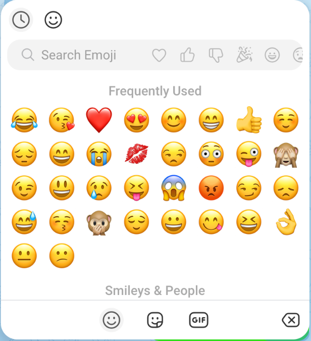
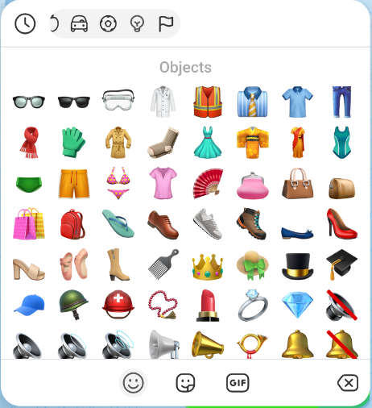
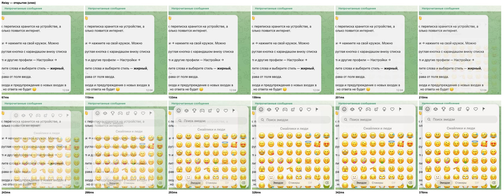
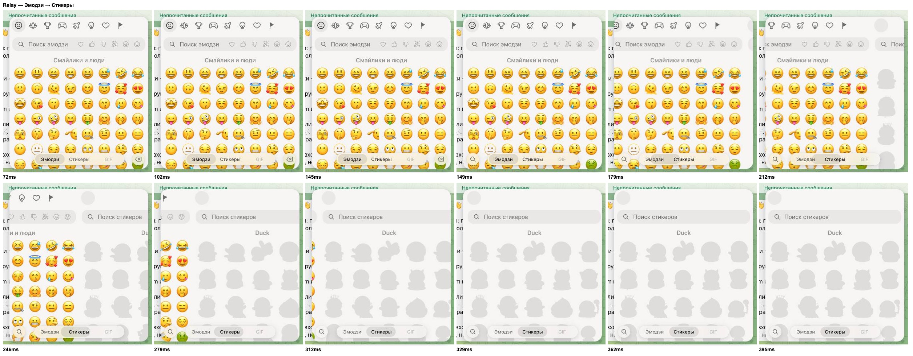
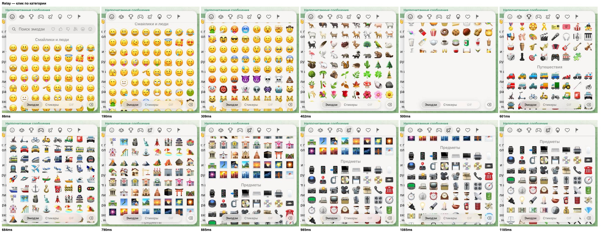
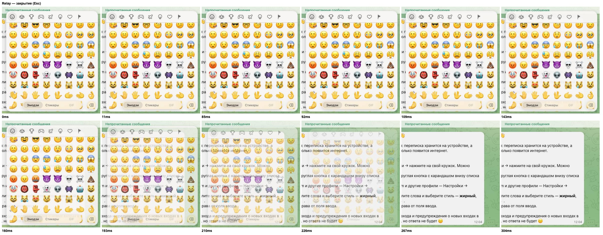
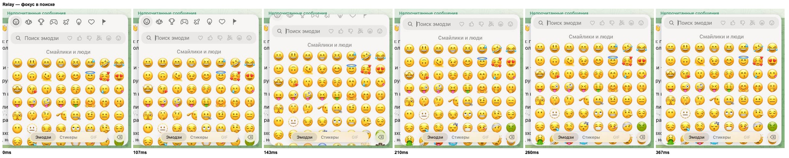
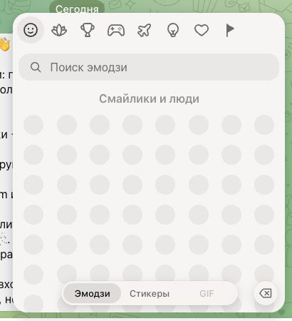
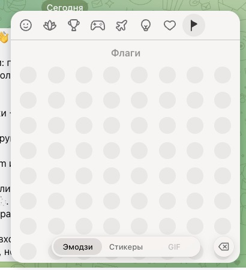
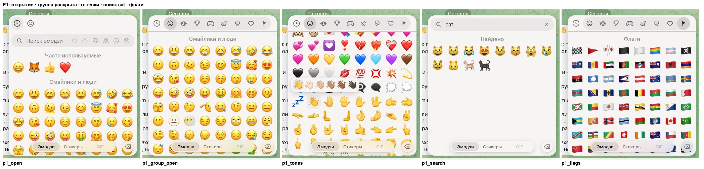

# Эмодзи-пикер: Relay против tweb (Telegram Web K)

Дата: 2026-10-26. Код Relay не менялся. Код tweb не копировался (GPL): ниже только описание поведения, числа и ссылки `файл:строка` в `~/Documents/tweb/src`.

## Как мерили

- **Relay.** Сборка в Docker: `https://127.0.0.1`, вход через `POST /dev/login`, чат «Relay». Отдельный Chrome под Playwright с окном 1280×860.
  - Каждый кадр `requestAnimationFrame` записывал вычисленные `opacity` и `transform` панели и вкладок, число узлов DOM и плиток, `scrollTop` и активную категорию.
  - Параллельно шёл CDP-скринкаст: раскадровки в `2026-10-26-emoji-picker-assets/relay_sheet_*.jpg`.
- **tweb.** `web.telegram.org/k` в Chrome пользователя, чат «Избранное», окно 1342×955 при DPR 2. Ничего не отправлялось, по эмодзи не кликали.
  - Тот же rAF-самописец, внедрённый в страницу. Длинные задачи ловил `PerformanceObserver('longtask')`.
- **Оговорки.**
  - У tweb в простое rAF шёл на 30 Гц, во время анимаций на 120 Гц (ProMotion). У Relay под Playwright всегда 60 Гц. Поэтому сравниваем длительности и состав кадров, а не FPS.
  - Задержку «клик → первый кадр» не сравниваем: инструменты кликают с разной задержкой.
  - В аккаунте tweb нет установленных наборов кастомных эмодзи, поэтому анимированные эмодзи разобраны по коду (`lib/customEmoji/renderer.ts`).

## Коротко

1. **Сетка у обоих одинаковая по геометрии.** Панель 382×420, ячейка 42 px, глиф 34 px, 8 колонок, `space-between`, зазор 4 px, поля 0 8 px, заголовки 16 px с отступами 12/14/6. Глиф в Relay отцентрован точно (смещение центра 0 px).
   - «Сетка лучше» в tweb держится на трёх вещах: полный набор эмодзи (около 1 809 против около 1 003 у нас, у нас урезаны флаги), выбор оттенка кожи и сворачиваемая группа в полосе категорий.
2. **Скелетона в tweb нет.** Есть три вещи, которые на него похожи:
   - спиннер 50 px при первом открытии, минимум 200 мс и во всё время анимации появления;
   - серые силуэты стикеров (у нас они тоже есть);
   - серые круги-заглушки под PNG-эмодзи на не-Apple системах.
3. **Анимированные эмодзи в tweb — это кастомные эмодзи Telegram** (премиум-наборы и их «недавние»).
   - Их рисует один `<canvas>` на категорию и общие плееры Lottie/WebM. Цикл один на всё приложение, 60 к/с. Вне экрана показываются статичные превью.
   - У Relay в пикере композера анимаций нет. При этом `EmojiTab` уже умеет проигрывать анимацию при наведении (`animate`), и это включено в `FolderEmojiPicker`, а в `SymbolMenu` не передаётся.
4. **В переходах есть где tweb лучше, а где мы.**
   - **tweb лучше при переходе к категории:** 150 мс и без пустот. У нас 1,1 с полёта через все категории, мигает индикатор и пролетают пустые ряды.
   - **tweb лучше в том, что позиция сохраняется между открытиями.**
   - **Relay лучше при первом открытии:** эмодзи уже в первом кадре, без спиннера и без длинных задач. У tweb длинная задача 69 мс и плитки «выпрыгивают» после анимации.
   - **Relay лучше при первой смене на «Стикеры»:** у tweb уезжает пустая вкладка, потом появляется спиннер.

## Таблица сравнения

| Аспект | Relay (замер / код) | tweb (замер / код) |
|---|---|---|
| Где живёт панель | `.rl-symbols-pop`, `composer.js:51-85`, `SymbolMenu.tsx`; после первого открытия остаётся в DOM (`display:none`) | `EmoticonsDropdown` (`emoticonsDropdown/index.ts`), после первого открытия остаётся в DOM (`dropdownHover.ts:274`) |
| Размер панели | 382×420, радиус 20 | 382×420 (`_emojiDropdown.scss:13-14`) |
| Ячейка эмодзи | 42×42, `font-size` 34, `line-height` 42 (`app.css:1258-1259`) | 42×42, 34 px, `padding 5px 4px` для нативных на Apple (`base.scss:1514-1611`) |
| Колонки | 8 (`repeat(auto-fill,42px)`), `space-between`, `column-gap` 4 | 8, по формуле `category.ts:124-137`, та же CSS-сетка |
| Источник картинок | только системный шрифт везде (`font-family` вычисляется в Arial → fallback на цветной шрифт ОС) | macOS/iOS: нативный глиф; остальные ОС: PNG 64×64 по одному на эмодзи, `loading=lazy`, серый круг-заглушка и проявление за 200 мс (`emojiImage.ts`, `emoji.ts:66-149`) |
| Набор эмодзи | ≈1 003, 8 категорий, флагов ≈70, без оттенков кожи (`emojiData.ts`) | ≈1 809 (`config/emoji.ts`), символы внутри «Объектов», все флаги, оттенки |
| Оттенок кожи | нет | ПКМ или удержание 400 мс → поповер 203 px, 0,2 с; выбор запоминается для каждого базового эмодзи (`emojiTonePicker.tsx`) |
| «Часто используемые» | до 32, снимок `localStorage` на время показа, после закрытия пересборка | до 32 плюс отдельный безымянный ряд кастомных; обновления откладываются до `closed` (`tab.ts:449-463`) |
| Полоса категорий | 49 px сверху, кнопки 38 px, все 8 иконок видны, активная — заливка; центрирование плавной прокруткой | 49 px; «Недавние» плюс **сворачиваемая группа** 7 категорий: 30 px (1 иконка) → 136 px при активной категории, ширина анимируется 0,2 с (`_emojiDropdown.scss:251-307`); активная — заливка, без бегунка |
| Scroll-spy | на каждый `scroll`: `requestMeasure` + `offsetTop` всех секций (`SymbolMenu.tsx:125-133`); во время программной прокрутки **не блокируется** | 1 px-сторожа + IntersectionObserver; во время программной прокрутки игнорируется (`index.ts:583-609`) |
| Клик по категории | нативный `scrollTo({behavior:'smooth'})` на всю дистанцию | прыжок к точке «цель − 150 px» плюс анимация последних 150 px за 150 мс ease-in-out; цель монтируется до прокрутки (`index.ts:611-661`, `fastSmoothScroll.ts:199-235`) |
| Ленивый рендер эмодзи | секция наполняется при подходе на 300 px (`rootMargin`) и **больше не выгружается**; первые 2 секции сразу | секция монтируется при пересечении (без `rootMargin`) и **выгружается**, когда уходит; узлы плиток хранятся в JS (`emoji.ts:361-454`) |
| Узлы DOM, эмодзи | первое открытие: 563 узла / 449 плиток; после пролистывания всего: 1 627 / 1 003 | первое открытие: 1 407 / 589; дальше 500–1 100 плиток в зависимости от позиции; при уходе на стикеры эмодзи выгружаются (320 узлов) |
| Поиск | строка внутри прокрутки, чипы групп Telegram (анимированные иконки); при фокусе полоса уезжает вверх за 200 мс standard, содержимое поднимается на 49 px | то же поведение, но 0,3 с standard, а категории дополнительно сдвигаются на 0,5rem; смена результатов — кроссфейд 200 мс (`tab.ts:142-208`) |
| Вкладки | «пилюля» снизу: Эмодзи / Стикеры / GIF (GIF выключен); бегунок 240 мс; по бокам круглые кнопки поиска и стирания | иконки снизу: поиск · эмодзи · стикеры · GIF · стереть; без бегунка, смена фона и цвета 0,2 с |
| Состояния загрузки | спиннера нет; стикеры показывают контур, а без превью проявляются; чипы проявляются за 150 мс | спиннер 50 px без проявления: при первом открытии эмодзи минимум 200 мс, на стикерах и GIF до первых данных; стикеры: контур → WebP-превью → анимация с проявлением 0,2 с |
| Анимированные эмодзи | нет в композере; в выборе иконки папки анимация играет при наведении | кастомные эмодзи: один холст на категорию, общие плееры, один цикл 60 к/с, OffscreenCanvas там, где он есть, проявление 250 мс, вне экрана — статичные превью |
| Пауза анимаций | `beginHeavyAnimation(220)` на открытии/закрытии, `(250)` на смене вкладки | группа `emoticons-dropdown`: заблокирована на время открытия, на паузе при закрытии и смене вкладки, очереди загрузки стоят 400 мс |
| Позиция между открытиями | сбрасывается: через 230 мс после закрытия обе вкладки пересоздаются (`epoch`) | сохраняется: вкладка, прокрутка и активная категория остаются |

Скриншоты tweb:  

Раскадровки Relay (подпись под кадром — мс от начала записи):

## Раскладка по кадрам

Время отсчитывается от начала записи; «кадр» — один rAF. `s` — scale, `o` — opacity, `x` — translateX в px.

### 1. Первое открытие (клик)

**Relay** (`relay_sheet_open.jpg`):

| t, мс | Состояние |
|---|---|
| 92 | `display:flex`, o0, s0.85; содержимое уже в DOM: 518 узлов, **449 эмодзи** (2 первые секции), прокрутка 0 |
| 142 | класс `is-active` (через 2 rAF), подгружены 11 холстов чипов-групп |
| 175 → 358 | переход: o 0 → 1, s 0.85 → 1, ≈183 мс, `cubic-bezier(.4,0,.2,1)`, от правого нижнего угла |
| — | длинных задач нет, все кадры 16,7 мс |

**tweb**:

| t, мс | Состояние |
|---|---|
| 253 | длинная задача **69 мс** (`init()` панели) |
| 269 | `display:flex`, `.active`, o0, s0.85; содержимого нет: 70 узлов, **спиннер** |
| 336 → 519 | переход: o 0 → 1, s 0.85 → 1, ≈200 мс, та же кривая; всё время анимации внутри только спиннер |
| 519 | спиннер убран |
| 535 | **сразу 589 плиток** (1 406 узлов), без проявления: появляются скачком в уже раскрытой панели |
| 785 | кадр **199 мс** (раскладка и отрисовка нативных глифов) |

**Вывод:** первое открытие в Relay плавнее. Не переносить отсюда спиннер и «выпрыгивание» плиток.

### 2. Повторное открытие (наведение)

| | Relay | tweb |
|---|---|---|
| Задержка наведения | 200 мс (`useHoverMenu openMs`) | 200 мс (`TOGGLE_TIMEOUT`) |
| Первый видимый кадр | ≈323 мс: `display`, o0, s0.85 | ≈368 мс: `display`, `.active` |
| Содержимое | уже в DOM (вкладки пересоздали после прошлого закрытия), поэтому прокрутка в начале | в первом кадре заново монтируется прошлая категория (485 плиток «Объекты»), а следующий кадр длится 33 мс при 8 мс у соседних |
| Анимация | o/s 0.85 → 1 за ≈183 мс | o/s 0.85 → 1 за ≈200 мс |
| Позиция | сброшена к началу | **та же, где закрыли** |

### 3. Закрытие

**Relay** (Esc; `relay_sheet_close.jpg`):

| t, мс | Состояние |
|---|---|
| 62 | `is-closing` |
| 95 → 245 | o 1 → 0, s 1 → 0.95, ease-in, `--dur-fast` (≈160 мс); в начале почти не двигается, к концу быстро |
| 262 | `display:none` |
| 312 | скрыто пересоздание вкладок: 1 627 → 669 узлов, позиция и стикеры сброшены |

**tweb** (клик по кнопке):

| t, мс | Состояние |
|---|---|
| 266 | снят `.active` |
| 266 → 467 | обратный ход: o 1 → 0, s 1 → 0.85, ≈200 мс, standard-кривая |
| 467 | `display:none` |
| 500 | секции эмодзи выгружены (1 698 → 728 узлов), стикеры и GIF возвращены к превью |

**Вывод:** обе версии без вспышек. В Relay закрытие короче и «уходит», а не схлопывается, и это осознанный выбор (как у меню). Разница только в том, что Relay сбрасывает позицию.

### 4. Смена вкладки Эмодзи → Стикеры

**Relay** (`relay_sheet_tab.jpg`):

| t, мс | Состояние |
|---|---|
| 91 | кадр подготовки: вкладка стикеров в раскладке, но `visibility:hidden` (`.is-prep`) |
| 157 → 341 | обе едут вместе: эмодзи 0 → −382, стикеры +382 → 0; 200 мс ease-in-out, без прозрачности |
| 149 | кнопки сбоку меняются мгновенно (стереть → поиск) |
| 224 | **посреди слайда** монтируются 74 стикера: 667 → 1 111 узлов, 31 → 105 холстов |
| 312–395 | стикеры ещё **серые контуры**: заехали силуэтами и оживают позже |
| 424 | уходящая вкладка скрыта (`hidden`) |
| — | на этой машине кадры 16,7 мс; тяжёлый кадр монтирования попадает на анимацию |

**tweb** (первая смена, стикеры ещё не построены):

| t, мс | Состояние |
|---|---|
| 247 → 447 | обе вкладки едут на ±382 px за 200 мс ease-in-out (`transform`, `.from`/`.to`, `transition.ts`); въезжает **пустая вкладка стикеров** с одной оболочкой |
| 456 | после `transitionend`: `init()`, появляется **спиннер** |
| 463 | 25 стикеров (превью), секции эмодзи выгружены: 1 410 → 320 узлов |
| 608 | длинная задача **113 мс** |
| 631 | ещё ≈400 узлов (полоса паков и секции) |

**tweb, обратно на Эмодзи (тёплая):** в первом кадре слайда монтируются 589 плиток (784 → 1 962 узла). Дальше три кадра по 24–32 мс при обычных 8 мс. Через 25 мс после конца слайда стикеры выгружены.

**Вывод:** схема «подготовить заранее, потом ехать» у Relay лучше, чем «ехать пустым, потом спиннер» у tweb. Но у нас тяжёлое монтирование стикеров попадает в середину слайда, а силуэты заметно долго висят после него.

### 5. Переход к категории (клик в полосе)

**Relay**, «Предметы», 4 435 px (`relay_sheet_cat.jpg`):

| t, мс | Состояние |
|---|---|
| 117 | старт нативной плавной прокрутки |
| 133 | индикатор → 5 (цель) |
| 166 | **индикатор обратно на 0**: scroll-spy перебил клик |
| 166 → 1 183 | индикатор ползёт 1 → 2 → 3 → 4 и в конце становится 5, то есть пробегает все категории |
| 400–540 | секции «Еда», «Занятия», «Путешествия» дорисовываются в полёте: на скриншоте 500 мс видны пустые ряды |
| — | отдельный замер: 2 кадра с пустой площадью до 229 px и кадр 139 мс |
| ≈1 200 | конец: ≈1,1 с |

**tweb**, «Объекты» (после «Недавних»):

| t, мс | Состояние |
|---|---|
| 62 | индикатор сразу на цели и дальше не меняется |
| 95 | **цель смонтирована до прокрутки** (589 + 485 плиток) |
| 128 | прокрутка мгновенно в точку «цель − 150 px» (6 476); старые секции выгружены |
| 128 → 228 | последние ≈130–150 px за ≈150 мс ease-in-out (6 476 → 6 607) |
| 95 → 262 | группа категорий раскрывается 30 → 136 px |
| — | промежуточные категории **не монтируются**, пустых кадров нет |

**Вывод:** это самое заметное отличие, переносим первым.

### 6. Прокрутка колесом

| | Relay | tweb |
|---|---|---|
| Монтирование | секции при подходе на 300 px, назад не выгружаются; к концу всё в DOM (1 627 узлов) | только видимые; при уходе выгружаются |
| Пустая площадь (быстрое колесо) | 4 кадра, до 157 px из ≈371 | 2 кадра, до **371 px** (весь видимый блок), плюс кадр 150 мс при повторном монтировании |

**Вывод:** при прокрутке колесом Relay ведёт себя лучше. Выгрузку как в tweb брать только вместе с запасом `rootMargin`.

### 7. Фокус в поиске (`relay_sheet_search.jpg`)

| | Relay | tweb |
|---|---|---|
| Полоса категорий | `translateY(-100%)` и `opacity 0` за 200 мс standard | сдвиг на −49 px за 0,3 с standard |
| Содержимое | −49 px за 200 мс | −49 px за 0,3 с, категории дополнительно +0,5rem |
| Смена списка на результаты | мгновенная подмена | кроссфейд 200 мс |

## Что перенести в Relay: поведение, а не код

### P0 — заметно глазом

1. **Быстрый переход к категории**, как в tweb.
   - Активную категорию в полосе ставить сразу и не давать scroll-spy менять её, пока идёт программная прокрутка. Освобождать по окончании или когда до цели меньше 1 px.
   - Целевую секцию монтировать до начала прокрутки.
   - Если до цели больше ~150 px, мгновенно встать в «цель − 150 px» и доанимировать остаток за ~150 мс ease-in-out. Нативный `smooth` с полётом через все категории не использовать.
   - Ожидаемый результат: не мигает индикатор, нет пустых рядов, нет кадра 139 мс, ≈150 мс вместо ≈1,1 с. Вверх — симметрично.
2. **Стикеры при смене вкладки не монтировать посреди слайда.**
   - Ячейки и статичные превью должны быть в кадре подготовки (`is-prep`).
   - Плееры и холсты запускать только после слайда, как в tweb: на время перехода стоят очереди загрузки и анимации.
   - Скрывать силуэты быстрее: превью WebP раньше, анимация с проявлением 0,2 с.
   - Цель: никаких серых силуэтов, которые въезжают и висят ещё ~250 мс.
3. **Сохранять позицию между открытиями.**
   - Вкладку, прокрутку и активную категорию не сбрасывать: не пересоздавать вкладки через `epoch` после каждого закрытия.
   - «Недавние» обновлять как в tweb: изменения копятся, пока панель открыта, и применяются после `closed` в той же разметке, без перемонтирования.

### P1 — функциональные пробелы

4. **Анимированные эмодзи в композере.** Передать в `EmojiTab` из `SymbolMenu` тот же `animate`, что уже работает в `FolderEmojiPicker`: анимация при наведении поверх глифа, ассеты уже есть (`animatedEmojiUrl`). Это ближайший к «живым эмодзи» шаг без кастомных эмодзи.
5. **Выбор оттенка кожи.**
   - Открывается правой кнопкой или удержанием 400 мс; движение пальца отменяет удержание.
   - Поповер над плиткой с отступом 8 px, при нехватке места — под ней. Показ: прозрачность и масштаб за 0,2 с standard.
   - Выбор запоминается для каждого базового эмодзи и сразу применяется ко всем его плиткам.
   - Пока поповер открыт, уход курсора не закрывает панель.
6. **Полный набор эмодзи:** все флаги и все эмодзи Unicode с порядком категорий как в Telegram (символы внутри «Объектов»). Сейчас ≈1 003 против ≈1 809.
7. **Сворачиваемая группа категорий в полосе.**
   - В покое видна одна иконка группы.
   - Когда активна категория из группы, группа раскрывается до ~136 px с подложкой, иконки уменьшаются до 0,8; ширина анимируется 0,2 с ease-in-out.
   - Так останется место под иконки наших наборов.
8. **Кроссфейд 200 мс при смене «категории ↔ результаты поиска».** Сейчас список подменяется мгновенно.

### P2 — по мере появления фич

9. **Картинки эмодзи для не-Apple систем.**
   - PNG или WebP по одному на эмодзи, `loading=lazy`.
   - Серый круг-заглушка ~28 px; при `load` картинка проявляется, а заглушка гаснет за 200 мс.
   - Уже загруженные адреса показывать без заглушки. Анимацию прозрачности вешать только на время проявления, иначе пересчёт стилей на тысячах плиток.
   - Графику Telegram и Apple не брать: нужен открытый набор (Noto Emoji — Apache 2.0, Twemoji — CC-BY 4.0) с проверкой лицензии.
10. **Кастомные (анимированные) эмодзи**, если появятся в протоколе.
    - Один холст на секцию, а не на плитку; общие плееры по ключу «документ + размер»; один цикл ~60 к/с на всё приложение.
    - Вне экрана и при закрытой панели — статичное превью. Анимации на паузе во время открытия, закрытия и смены вкладки.
    - Проявление 250 мс, если до этого не было превью.
11. **Ограничение DOM** — по желанию. Выгружать секции далеко за экраном (например, дальше 2 экранов), но с запасом `rootMargin` ≥ 300 px. Иначе получим пустые кадры tweb (371 px) и кадр 150 мс при возврате.

### Не переносить: у Relay уже лучше

- Спиннер на время анимации первого открытия и скачкообразное появление 589 плиток после неё: у нас содержимое готово к первому кадру.
- Пустая вкладка при первой смене и спиннер после слайда: наша схема «подготовка, потом слайд» правильнее.
- Монтирование только видимых секций без `rootMargin`: даёт полностью пустые кадры при прокрутке.

## Сделано (ветка `feat/apple-emoji-images`)

Замер тем же сценарием, сборка ветки, macOS UA (нативные глифы — как в замере «до»).

| Сценарий | До | После |
|---|---|---|
| Клик по категории «Предметы» (4 435 px) | нативный smooth ≈1,1 с; подсветка 5 → 0 → 1…5; секции дорисовываются в полёте, 2 кадра пустоты до 229 px, кадр 139 мс | подсветка 5 в первом кадре и до конца; цель и соседи наполнены до прокрутки (1 072 эмодзи); прыжок на 4 285 и доводка до 4 435 за ≈170 мс; два кадра по 33 мс на растре новых глифов |
| Смена Эмодзи → Стикеры | 74 стикера и 74 холста монтируются на 4-м кадре слайда; силуэты висят после него | вкладка стикеров строится скрытой через 400 мс после открытия, первые паки грузятся сразу; за весь слайд узлы DOM не меняются (1 111 → 1 111) |
| Закрыть и открыть снова | прокрутка 0, подсветка 0 (вкладки пересоздавались) | прокрутка 4 435 и подсветка «Предметы» сохранены; «Недавние» перечитываются после закрытия |

**Эмодзи Apple картинками** (P2.9, по решению владельца — изображения © Apple, см. `apps/web/public/emoji/apple/NOTICE.md`): на macOS/iOS остаётся шрифт, на остальных системах — PNG 64×64 с серым кругом-заглушкой и проявлением 200 мс; у всех 1 003 эмодзи панели есть файл (тест `emojiImage.test.ts`).

 

### P1 / P2

| Пункт | Что сделано | Замер |
|---|---|---|
| P1.4 Анимация при наведении | в композере `EmojiTab` получает `animate` (каталог `/animated-emoji`); ячейка — свой компонент со своим наведением, сетка при наведении не перерисовывается | анимация встаёт поверх глифа, длинных задач нет |
| P1.5 Оттенок кожи | правая кнопка или удержание пальцем 400 мс (сдвиг > 8 px отменяет) → ряд из 6 вариантов над плиткой (под ней, если сверху тесно), прозрачность и масштаб 0,9 → 1 за 200 мс; Esc, щелчок мимо или прокрутка закрывают только меню; выбор вставляется и запоминается для базового эмодзи (`relay.emoji.tones`), сетка показывает выбранный вариант | 👋 → 👋🏾 вставлен, в сетке 👋🏾 |
| P1.6 Полный набор | `apps/web/scripts/genEmoji.ts` из emoji-datasource 16.0.0 (MIT) → `emojiTable.ts`: 1 867 эмодзи (было 1 003), 291 с оттенками, все флаги; поиск ещё и по английским именам Unicode («cat», «thumbs up») | у каждого эмодзи и оттенка есть картинка (тест) |
| P1.7 Группа категорий | 8 категорий — группой в полосе: при подсвеченных «Часто используемых» свёрнута в одну иконку (40 px), категория внутри — раскрыта на подложке до 320 px, иконки 0,85, ширина 200 мс ease-in-out; без «Часто используемых» группа всегда раскрыта | 40 → 320 px за 12 кадров |
| P1.8 Кроссфейд | смена «категории ↔ поиск ↔ фильтр»: снимок прежних секций гаснет поверх новых, новые проявляются, 200 мс standard; набор букв внутри поиска — без анимации | снимок 1 → 0 и новое 0 → 1 за ≈200 мс; при наборе ещё букв снимков нет |
| P2.9 Картинки эмодзи | см. выше (Apple PNG на не-Apple системах) | — |
| P2.10 Кастомные эмодзи | **не сделано**: в протоколе Relay нет кастомных эмодзи (наборов и документов эмодзи) — рендерер не на чем строить; нужна фича сервера и протокола | — |
| P2.11 Ограничение DOM | секция наполняется за 300 px до экрана, опустошается через 500 мс после ухода дальше 1 200 px (не посреди перехода или броска); в скрытой вкладке и закрытой панели держится | у «Флагов» в DOM 2 секции из 9, 491 эмодзи из 1 867; переход к категории — 0–1 кадр > 20 мс в трёх прогонах |

Осталось заметным: при смене вкладки бывает один кадр 33 мс в середине слайда без изменений DOM — растр въезжающего слоя (первая секция теперь 519 эмодзи вместо 254).

## Слабая машина (CPU ×4 и ×6)

Замедление CPU через CDP (`Emulation.setCPUThrottlingRate`), сборка ветки поверх Docker-сервера. Кадры каждого rAF делятся на фазы: **до движения** (от нажатия до первого сдвинутого кадра — «стоп-кадр»), **движение**, **после**. Причины — по трассам Chrome (`devtools.timeline`, `invalidationTracking`) и профилю JS.

### Найденные причины

| Причина | Где | Цена | Исправление |
|---|---|---|---|
| Правило `.app-listwrap:has(> .rl-presence[data-state="open"]) > :not(.rl-presence)` — `:has()` не в позиции субъекта | `apps/web/public/app.css` (скелетон списка) | **любая** вставка или удаление узла в колонке чата пересчитывала стили ≈1 350 элементов (весь чат), не только в пикере | `:has()` ставит переменную на саму обёртку, дети берут `visibility: var(…)` — вставка стоит 5 элементов |
| Правило `.rl-shell :has(> .rl-glassbar .app-pins) …` — `:has()` без якоря | там же (липкая дата под закрепом) | любая вставка в `body` — тот же пересчёт ≈1 350 элементов | якорь — колонка чата: `.rl-shell .app-chatcol:has(…)` (шапка всегда её прямой ребёнок) |
| Смена класса, `inert` и `pointer-events` на вкладке в первом кадре слайда | `SymbolMenu.tsx` | пересчёт стилей всего дерева вкладки (1 700 элементов, 20–35 мс при ×4…×6) | слайд — Web Animations по инлайн-`transform`; вкладки — постоянные слои (`will-change`); новая вкладка рисуется за краем в кадре подготовки; нажатия во время слайда ловит прозрачный щит |
| Сотни эмодзи монтируются одним кадром (открытие — 600+, переход к категории — три секции) | `EmojiSection` | задача 110–200 мс | секции наполняются частями по 64 плитки за кадр через общую очередь, со стороны, откуда видны, и не во время анимаций; переход наполняет до прокрутки только видимое (начало цели, конец предыдущей) |
| Плеер Lottie на паузе освобождал кэш кадров (`trim`/`drop`) в первом кадре тяжёлой анимации; PNG-превью (`convertToBlob`, ≈30 мс при ×6) кодировалось в «простое» посреди слайда | `packages/relay-ui/src/lottie/player.js`, `previews.js` | 10–30 мс JS в кадрах движения | освобождение и кодирование — после тяжёлой анимации |

### До / после (медианы по 2–3 прогонам; «длинных в движении» — кадры > 20 мс, по прогонам)

| Сценарий | ×4 до | ×4 после | ×6 до | ×6 после |
|---|---|---|---|---|
| Первое открытие | старт 264 мс, стоп-кадр 100 мс; в движении 1/1 | старт 255, стоп-кадр 83; 2/0/0 | старт 341, стоп-кадр 183; 2/1 (макс 50) | старт 273, стоп-кадр 117; 1/2/1 (макс 50) |
| Эмодзи → Стикеры | старт 189, стоп-кадр 50; 0/1 | старт 149, стоп-кадра нет; **0/0/0** | старт 251, стоп-кадр 67; 3/1 | старт 198, стоп-кадр 50; 1/1/0 |
| Стикеры → Эмодзи | старт 191, стоп-кадр 33; 1/0 (макс 50) | старт 229, стоп-кадр 50; 0/0/1 (макс 33) | старт 304, стоп-кадр 67; 1/0 | старт 292, стоп-кадр 117; 1–3 кадра по 33–50 |
| Переход к категории | старт 203, стоп-кадр 83; 1/0 | старт 122, стоп-кадра нет; 1/0/0 | старт 270, стоп-кадр 150; 0/1 | старт 192, стоп-кадр 67; 2/0/1 |

Вставка узла внутри панели: **1 348 → 5** пересчитанных элементов (в `body`: 1 354 → 1). Это касается всего приложения, не только пикера.

Остаётся при ×6: возврат на «Эмодзи» — 1–3 кадра по 33–50 мс в движении и стоп-кадр ≈117 мс до него (показ вкладки из `display: none`: стиль + раскладка + отрисовка ≈1 300 узлов); по трассе в кадрах движения — сборка слоёв (Layerize ≈12 мс) и очистка уходящей вкладки в конце слайда. Проверенная гипотеза «перерисовка подписи вкладки из-за перехода цвета» не подтвердилась (без перехода — тот же разброс). На ×4 движение чистое во всех сценариях, кроме одиночных кадров 33 мс.
